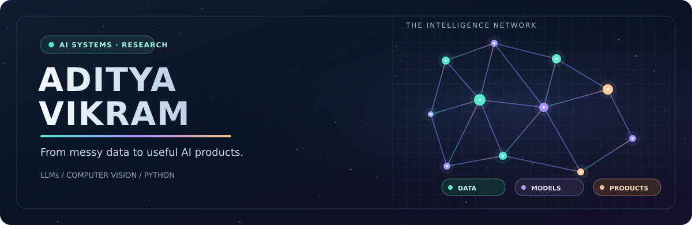
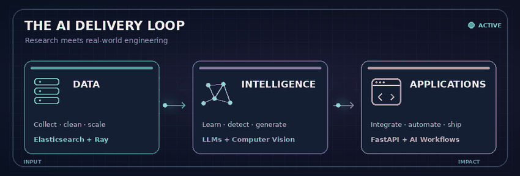

<!-- Original GitHub profile design for Adityav20: From Data to Deployed AI -->

  

  
<strong>M.Sc. Computer Science (AI) · Bauhaus-Universität Weimar</strong>

  
Building AI systems that move beyond experiments: from messy data to models, APIs, and applications.

  
  
  
  

## About me

I am a master's student in Computer Science, specializing in applied AI, and a hands-on developer interested in the entire ML lifecycle: **data preparation → experimentation → reliable software**.

- **LLM applications:** language models, RAG, agents, NLP, and AI-enabled automation.
- **Computer vision:** deep learning for object detection and microscopy image analysis.
- **Large-scale data:** Python pipelines, Elasticsearch, Ray, and research datasets.
- **Production-facing code:** FastAPI services, integrations, real-time apps, and developer tooling.
- **Based in:** Weimar, Germany · **Open to:** Werkstudent / internship opportunities in AI, ML, and Python development.

## Selected work

| Project | What I built / explored | Tools |
| --- | --- | --- |
| **[VocabForge — German vocabulary extractor](https://github.com/Adityav20/vocabforge-cefr-german)** | Extracts German vocabulary from documents, organizes words by CEFR level, and generates downloadable study material. **Public GitHub repository.** | Python, FastAPI, spaCy, NLP |
| **Archive Query Log — master's research** | Analyzed search-result URLs in a **1.8 TB** research dataset, with provider-level sampling and query-parameter analysis. | Python, Elasticsearch, Ray, Pandas |
| **Microscopy object detection** | Trained and applied YOLOv8 to recognize cement materials and structural features in microscopy images. | Python, YOLOv8, Computer Vision |
| **Language models from scratch** | Implemented and compared N-grams, feed-forward language models, LSTMs/GRUs, and tokenization strategies. | PyTorch, NLP, Tokenizers |
| **Generative AI storytelling** | Prototyped multi-user AI-generated storytelling with character creation and real-time interactions. | FastAPI, LLM APIs, WebSockets |

*Research and university projects are described here even where their source code is not public.*

## Engineering toolbox

**Languages & backend:** Python · SQL · FastAPI · Flask · JavaScript · WebSockets  
**Machine learning:** PyTorch · TensorFlow · Scikit-learn · Hugging Face · YOLOv8  
**LLM workflows:** RAG · LangChain · Ollama · OpenAI API · n8n  
**Data & infrastructure:** Pandas · NumPy · Elasticsearch · Ray · Docker · Git

## GitHub activity

  
  

## How I think about building AI

  

<em>Research. Prototype. Validate. Integrate. Improve.</em>

<!-- GitHub's image hover title is browser-dependent. Statistics require external services. -->
